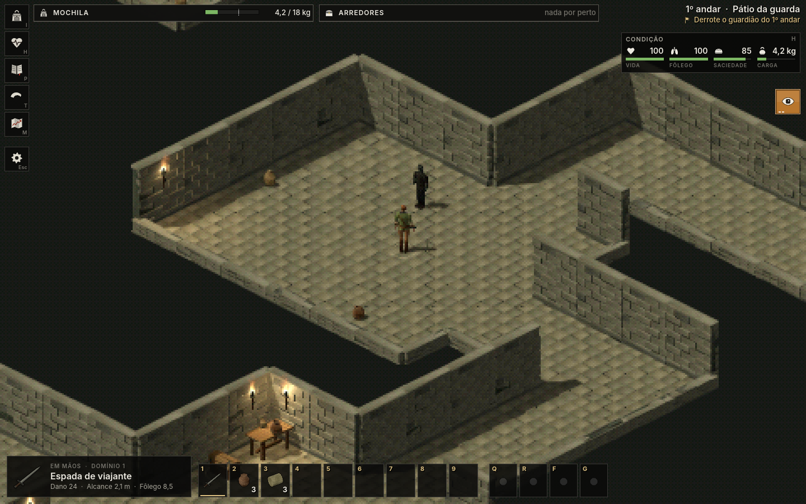
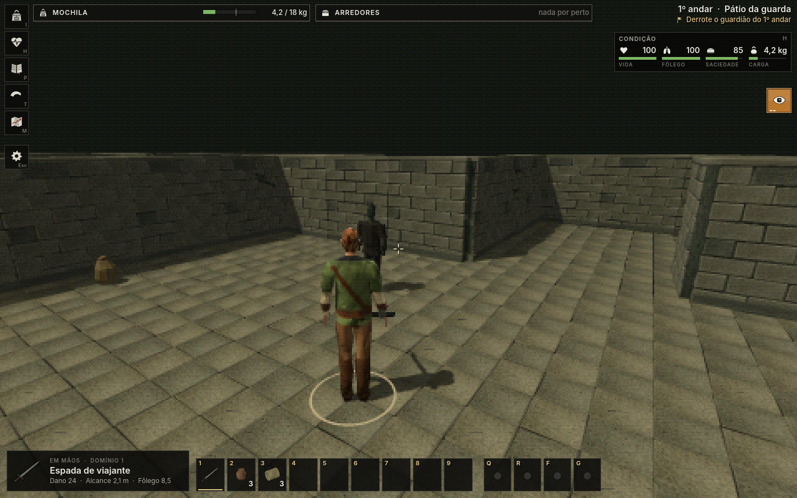
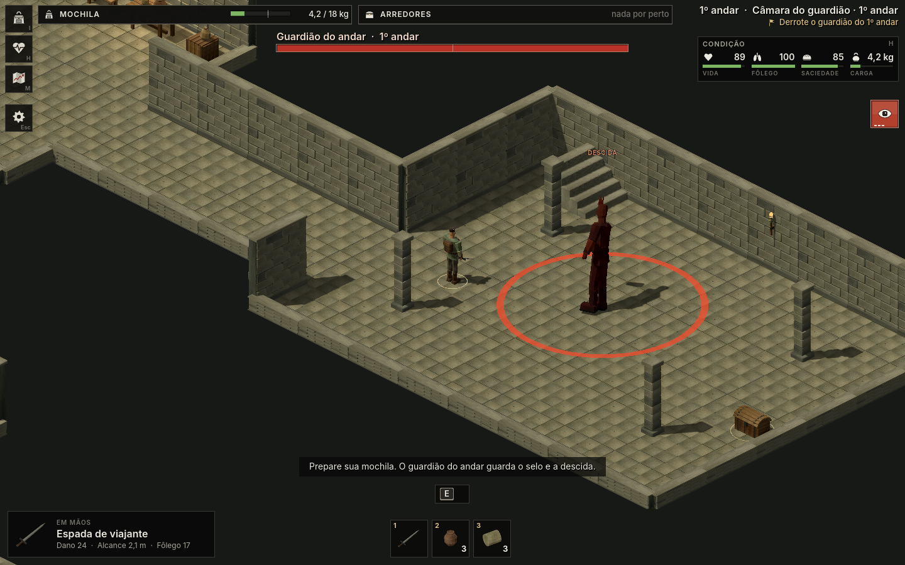
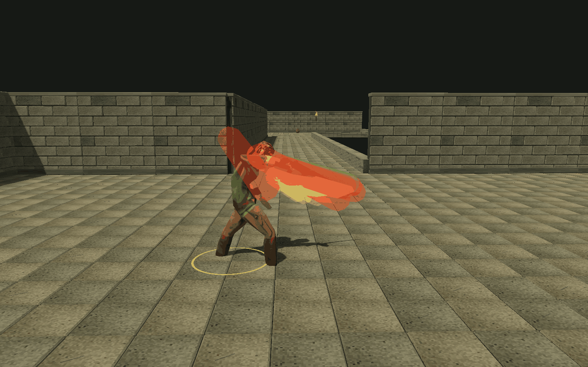
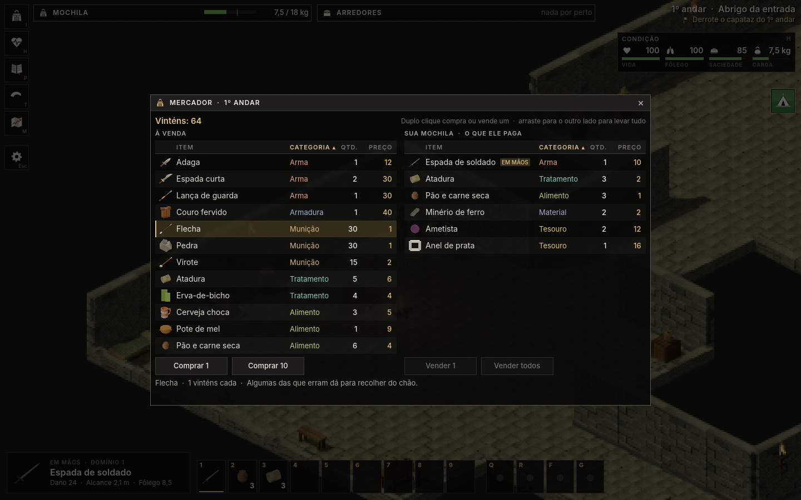
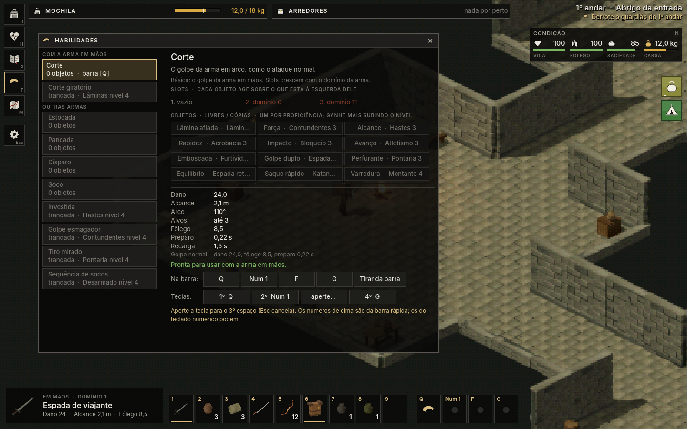
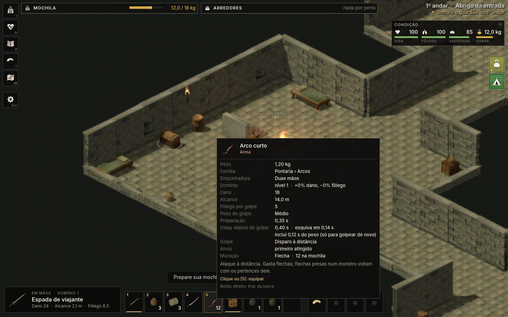

# Dungepm — As Cisternas

Dungeon crawler de sobrevivência com cara de PlayStation 1, feito na Godot 4.7.

Você desce pelas cisternas com uma mochila, um pouco de comida e uma arma. Cada expedição gera um labirinto novo. Explore as salas, cuide da fome, do fôlego e dos ferimentos, troque o que achar com o mercador e derrote o capataz de cada andar para abrir a descida. Se o aventureiro morrer, ele não volta: o próximo começa do zero, mas lembra o mapa que você já explorou.



## Baixar e jogar

Não precisa instalar nada: o jogo inteiro vai dentro do executável.

| Sistema | Download | Como abrir |
|---|---|---|
| Windows (64 bits) | [Dungepm-windows.zip](https://github.com/Louzada-git/Dungeon-Crawler/raw/main/downloads/Dungepm-windows.zip) (47 MB) | Extraia (botão direito → **Extrair tudo**) e abra `Dungepm.exe`. Se o Windows avisar que o programa não é conhecido, clique em **Mais informações → Executar assim mesmo**. |
| Linux (64 bits) | [Dungepm-linux.tar.xz](https://github.com/Louzada-git/Dungeon-Crawler/raw/main/downloads/Dungepm-linux.tar.xz) (29 MB) | Extraia e abra `linux/Dungepm.x86_64`. Se não abrir com dois cliques: `chmod +x Dungepm.x86_64` e `./Dungepm.x86_64`. |

Precisa de placa de vídeo com OpenGL 3.3. O jogo é em português. Os créditos e as licenças vão junto nos dois pacotes.

## O que tem no jogo

**Labirinto**
- Gerado por semente a cada expedição. O 1º andar tem 10 salas, e cada andar seguinte é maior (20, 40, 60…).
- Salas de combate, de suprimentos, de tesouro, covis com o carcereiro (elite) e a câmara do capataz, que guarda a descida.
- Um mercador na entrada de cada andar compra e vende com vinténs. O estoque muda de andar para andar.
- Baús abertos e monstros mortos continuam assim quando você volta a um andar. Alguns baús são trancados e precisam de gazua.

**Sobrevivência**
- Fome, fôlego, carga da mochila e ferimentos que sangram até você tratar com bandagens ou unguento.
- O abrigo do 1º andar é o único lugar seguro: lá você descansa e salva.
- 77 itens: comida, bebida que devolve fôlego, curativos, armaduras leves e pesadas, gazuas, chave-mestra, mapa do andar e tesouros para vender.

**Combate**
- 31 armas, cada uma com seu jeito: espadas, sabre e alfanje cortam, lanças, pique, alabarda e tridente estocam em linha, maças, marretas e martelos esmagam (e furam armadura), machados e lâminas serrilhadas fazem sangrar, adagas matam quem não te viu, e arcos, bestas e funda atiram munição que dá para recolher (flechas de osso, de ponta larga, virotes pesados…).
- O golpe acerta quem a arma encosta: cada arma tem uma hitbox do tamanho do modelo que segue a animação, e o alcance mostrado é o da lâmina. Os monstros acertam com a garra e se jogam no golpe; recuar no preparo escapa.
- Arma pesada bate forte e demora para golpear de novo: cada kg da arma soma 0,1 s de espera.
- Guarda com o botão direito, esquiva, corrida, andar agachado e ataque furtivo.
- Cinco tipos de monstro: afogado, carniçal (rápido), inchado (resistente), carcereiro de elite e o capataz do andar, com pancada em área e fúria na metade da vida.

**Personagem**
- No começo você distribui 25 pontos entre Força, Vigor, Agilidade e Destreza e escolhe a arma inicial (ou começa de punhos).
- Proficiências que sobem com o uso, no estilo de Oblivion, em três grupos: Combate, Furtividade e Sobrevivência. Os ramos dão talentos a partir do nível 5.
- Habilidades com objetos encaixados: cada objeto muda a habilidade (Lâmina afiada faz sangrar, Braço longo estica a lâmina, Golpe duplo acerta duas vezes…), e a ordem dos objetos importa. As teclas das habilidades são você quem escolhe.
- Barra rápida de 1 a 9 com qualquer item.

**Visual**
- Filtro PSX: imagem em pixels grandes, cores reduzidas, texturas sem suavizar e vértices que tremem, como no PS1. Pode desligar.
- Câmera isométrica ou em terceira pessoa, à sua escolha.
- A arma fica na mão fechada, e cada tipo é carregado do seu jeito: duas mãos no cabo, haste de pé, arco na mão esquerda, besta na cintura, braços soltos de mãos vazias.
- Sangue, faíscas, poeira, fumaça e tochas com chama animada.

| | |
|---|---|
|  |  |
| Câmera em terceira pessoa | O capataz avisa a pancada em área com um anel vermelho |
|  |  |
| A hitbox da espada ao longo do golpe (em verde, a posição do impacto) | A loja do mercador |
|  |  |
| Habilidades: objetos, prévia e teclas | Barra rápida de 1 a 9 |

## Controles

| Ação | Controle |
|---|---|
| Mover | WASD ou setas |
| Atacar | Botão esquerdo |
| Mirar / guarda | Segurar botão direito |
| Correr | Shift |
| Esquivar | Espaço |
| Andar agachado | C |
| Interagir / abrir baú / arrombar / loja | E |
| Inventário | I ou Tab |
| Mapa explorado | M |
| Condição física | H |
| Barra rápida (qualquer item) | 1 a 9 |
| Proficiências | P |
| Habilidades: montar e trocar teclas | T |
| Habilidades: usar | Q, R, F, G (ou as que você escolher) |
| Câmera isométrica ou terceira pessoa | Esc → Câmera |
| Aproximar / afastar câmera | Roda do mouse |
| Terceira pessoa: soltar o cursor | Segurar Alt |
| Pausar | Esc |
| Salvar no abrigo | F5 |

## Primeiros passos

1. Monte o aventureiro: distribua os pontos e escolha a arma.
2. No abrigo, pegue o que precisar dos baús e veja o que o mercador vende. Comida e bandagens ocupam a barra rápida desde o começo.
3. Explore o andar. Chegue agachado (C) em monstros que ainda não te viram para um ataque furtivo.
4. Chegue perto o bastante para a arma encostar, e recue quando o monstro preparar a garra. Sem fôlego, você não esquiva nem segura a guarda.
5. O capataz fica na sala mais distante. Derrote-o para abrir a descida.
6. Volte ao abrigo e use o ponto de descanso (E) para salvar.

## Rodar pelo código

1. Instale a [Godot 4.7.2](https://godotengine.org/download/).
2. Abra `jogo/project.godot` e aperte F5.

Testes automáticos (da pasta `jogo/`):

```
godot --headless --path . -- --test
godot --headless --path . -- --test-labirinto --seed=777
```

O primeiro testa o mundo fixo (combate, inventário, save, HUD, habilidades, câmera…), e o segundo testa o labirinto gerado. Para gerar os executáveis, use os presets **Linux** e **Windows** de `jogo/export_presets.cfg`, e depois `./empacotar.sh` para montar os pacotes.

## Estrutura

| Pasta | O que tem |
|---|---|
| `jogo/` | Projeto da Godot: cenas, scripts, dados em JSON e assets. O mapa do código está em `jogo/ARQUITETURA.md`, e os números de armas e monstros em `jogo/BALANCO.md`. |
| `jogo/data/` | Itens, monstros, proficiências, habilidades, saque, efeitos e textos. Dá para balancear o jogo sem mexer no código. |
| `outputs/` | Guia do jogador com as novidades de cada versão (`LEIA-ME.md`) e o registro dos testes (`VERIFICACAO.md`). |
| `downloads/` | Os pacotes para Windows e Linux. |
| `arte/` | Fontes da arte e os scripts que preparam modelos, texturas e efeitos. |
| `revisao/` | Capturas de tela de cada etapa. |

## Créditos

Engine: [Godot](https://godotengine.org/) (MIT). Fonte: [Inter](https://github.com/rsms/inter) (SIL OFL 1.1).

| Asset | Autor | Licença |
|---|---|---|
| Aventureiro, mercador e monstros (Characters PSX) | [Elbolilloduro](https://elbolilloduro.itch.io/characters-psx) | CC0 |
| Animações (Universal Animation Library) | [Quaternius](https://quaternius.com) | CC0 |
| Corte do sabre e rig dos personagens | [Mixamo](https://www.mixamo.com/) (Adobe) | Termos do Mixamo |
| Adaga, faca, espada curta, montante, machado, maça, marreta e lanças (RPG Weapons) | [Binbun](https://binbun3d.itch.io/rpg-weapons) | CC0 |
| Sabre, alabarda, arco, besta, flecha e virote (Low Poly Weapon Pack) | Kickin' It Studios | Uso livre em jogos |
| Treze armas novas, de espada larga a foice (3D Fantasy Weapons Pack) | Polyy, **modelos gerados por IA** | CC0 |
| Comida, bebida, tesouros e ferramentas (Fantasy Props MegaKit) | [Quaternius](https://quaternius.com) | CC0 |
| Efeitos visuais (Brackeys VFX Bundle) | Brackeys, com texturas de CodeManu e Thomas Iché | CC0 |

Cenário, móveis e parte dos objetos são arte própria do projeto. A lista completa, com o modelo de origem de cada item, está em `jogo/ASSETS.md`.

## Licença

O código e a arte própria ainda não têm licença pública: dá para ver e jogar, mas não reaproveitar sem autorização. Os assets de terceiros seguem a licença de cada autor (tabela acima).
